<p align="center">
  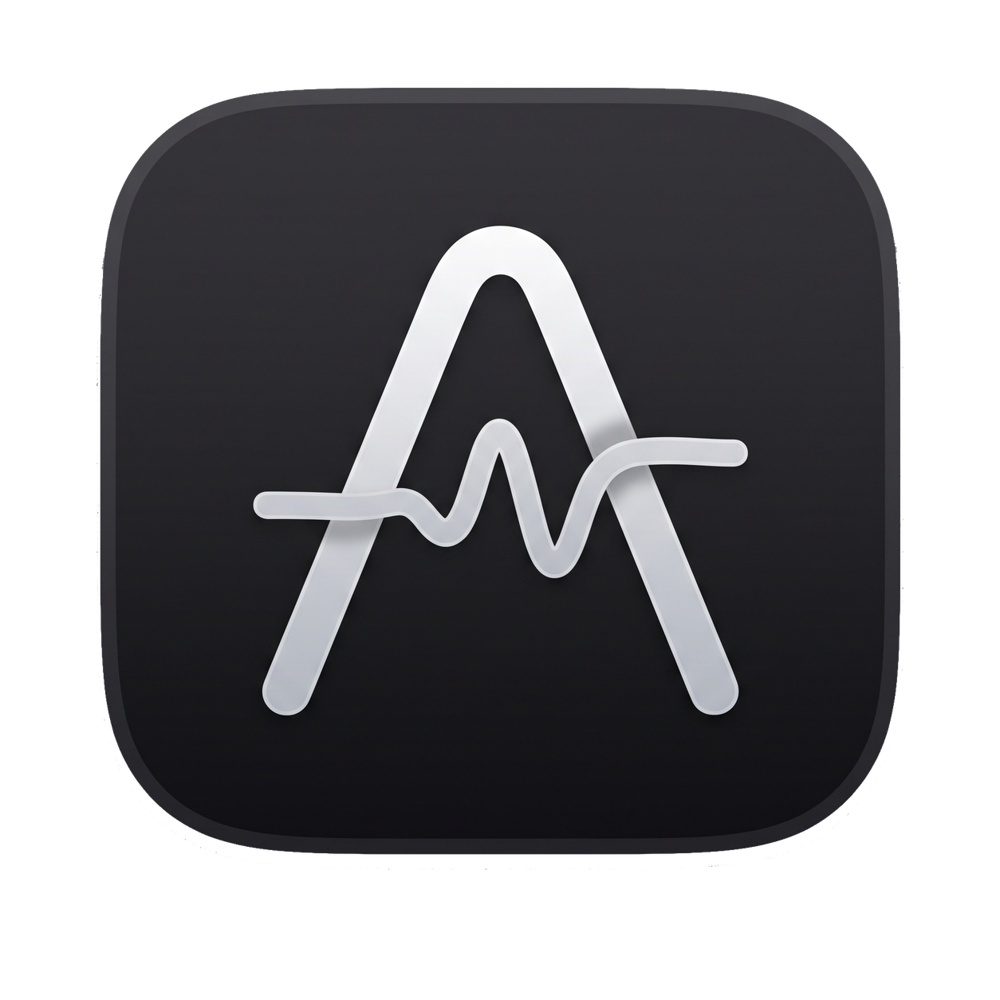
</p>

<h1 align="center">Aoede</h1>

<p align="center"><strong>Your music. Your server. Your people.</strong></p>

<p align="center">
  A self-hosted music platform for discovering, collecting and listening together.<br>
  Built around Navidrome, with a shared music pool and a personal space for every listener.
</p>

<p align="center">
  <a href="https://github.com/sPROFFEs/Aoede/actions/workflows/quality.yml"></a>
  <a href="https://github.com/sPROFFEs/Aoede/releases/latest"></a>
  <a href="LICENSE"></a>
</p>

<p align="center">
  <a href="#why-aoede">Features</a> ·
  <a href="#screenshots">Screenshots</a> ·
  <a href="docs/SCREENSHOTS.md">Full gallery</a> ·
  <a href="#clients">Get the app</a> ·
  <a href="#quick-start">Quick start</a> ·
  <a href="docs/README.md">Documentation</a>
</p>

<p align="center">
  <a href="docs/images/screenshots/desktop-vitrine-home.webp">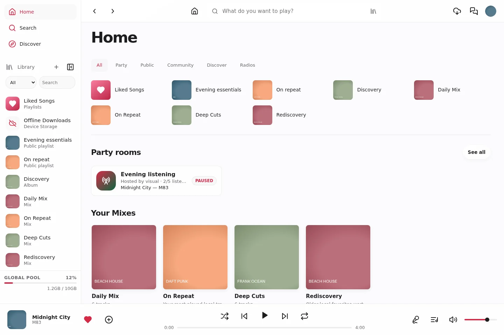</a>
</p>

<p align="center"><sub>Vitrine on desktop. Captured from the current frontend with a local demonstration library. Separate web and native Android galleries below.</sub></p>

## Why Aoede?

**Aoede 1.3.1** brings your library, discovery and shared listening to the web, native Android and desktop clients. Choose Classic, Glass or Vitrine without changing how you organize your music.

Keep audio on your own server, build collections that feel personal, and invite others to listen with you.

| | What you can do |
|---|---|
| **Discover and collect** | Search your library, Spotify and YouTube. Preview supported results and import supported album or playlist URLs into your own collections. |
| **Make it yours** | Organize playlists and curated albums, save favorites, build rule-based smart playlists and explore personal mixes. |
| **Listen together** | Invite collaborators, publish collections and join synchronized Party Rooms with shared queues. |
| **Connect your servers** | Optional **federation (beta)** connects catalogues, public profiles, collections, collaboration and parties across Aoede nodes. |
| **Keep listening** | Enjoy synchronized lyrics, the queue, live radio and a sleep timer. Save supported local tracks for offline listening. |
| **Look back** | Explore your listening statistics and an animated annual Aoede Wrapped when enabled by your administrator. |
| **Stay in control** | Manage users, downloads, library maintenance, duplicate review, backups and updates from the administration interface. |

Each regular account gets its own Navidrome instance, while the shared music pool lets users reuse audio without storing another copy for every account.

## Screenshots

Click any image for its full resolution. All images come from the real interfaces using fictional accounts, sample library metadata and demonstration artwork. Native Android images render the APK's actual Android views; mobile web images render the responsive website.

### Three themes, one account

**Classic** keeps a focused dark layout. **Glass** adds translucent, artwork-aware surfaces. **Vitrine** pairs an Apple Music inspired layout with rose accents and light/dark appearance. Your theme preference follows your account between devices. [Theme guide](docs/THEMES.md)

<table>
  <tr>
    <td width="33%" align="center"><a href="docs/images/screenshots/desktop-classic-home.webp">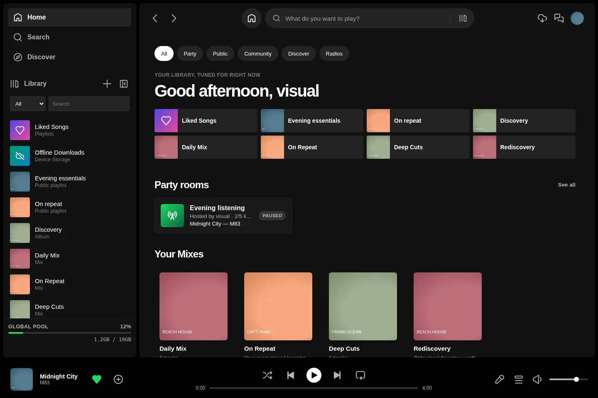</a></td>
    <td width="33%" align="center"><a href="docs/images/screenshots/desktop-glass-home.webp">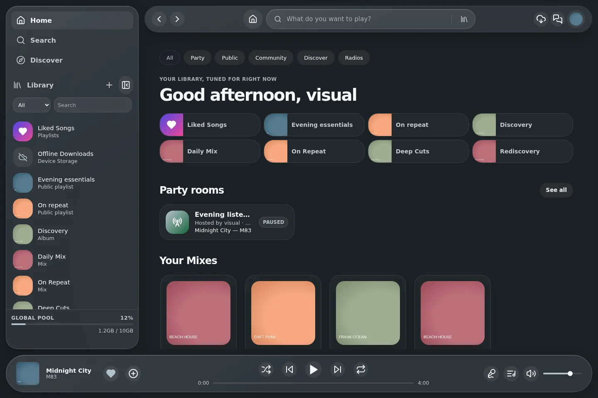</a></td>
    <td width="33%" align="center"><a href="docs/images/screenshots/desktop-vitrine-home.webp"></a></td>
  </tr>
</table>

### Discover, import and organize

Explore recommendations with explanations and category filters, audition a track, or preview a supported Spotify/YouTube collection before importing its ordered songs. Keep playlists, curated albums, favorites and smart playlists in your library. Artist pages connect local recordings with supported discovery sources.

<table>
  <tr>
    <td width="50%" align="center"><a href="docs/images/screenshots/desktop-glass-discovery.webp">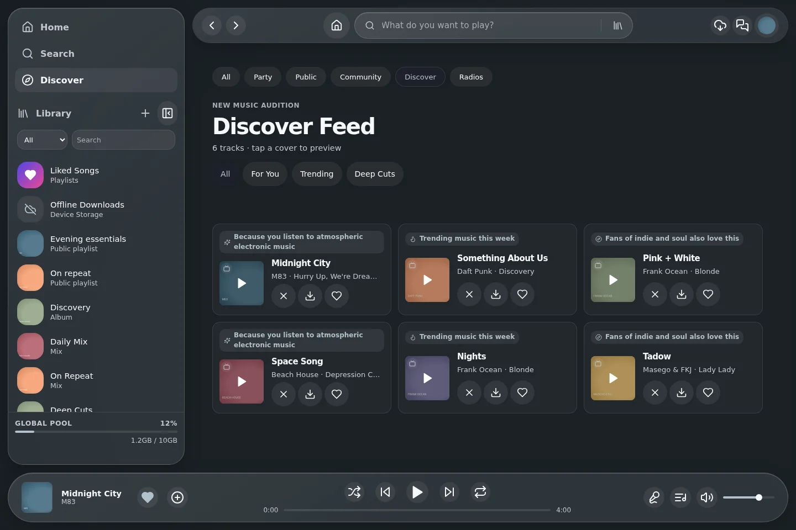</a></td>
    <td width="50%" align="center"><a href="docs/images/screenshots/desktop-vitrine-import.webp">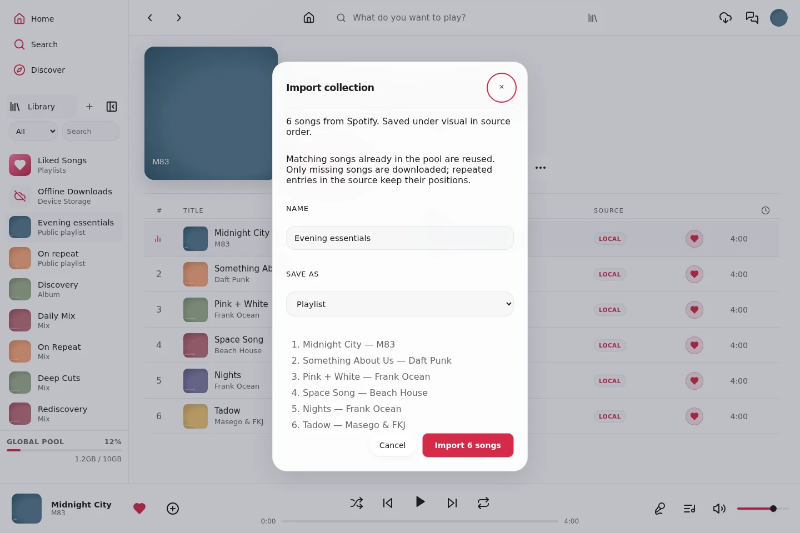</a></td>
  </tr>
</table>

### Listen together

Public profiles bring collections and listening activity together. Invite playlist collaborators, join a Party Room, or connect compatible servers through optional federation. Shared queues and remote collections retain the source of each recording. [Party Rooms](docs/PARTY-ROOMS.md) · [Community and collaboration](docs/USER-GUIDE.md#collaborative-playlists)

<table>
  <tr>
    <td width="50%" align="center"><a href="docs/images/screenshots/desktop-vitrine-profile.webp">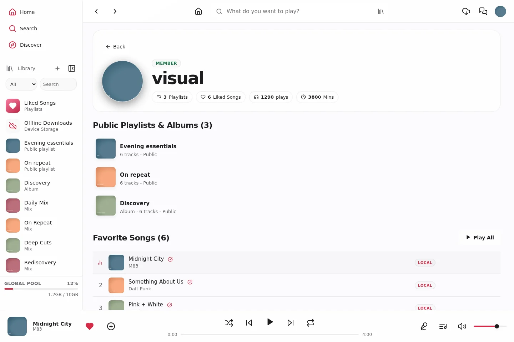</a></td>
    <td width="50%" align="center"><a href="docs/images/screenshots/desktop-classic-party.webp">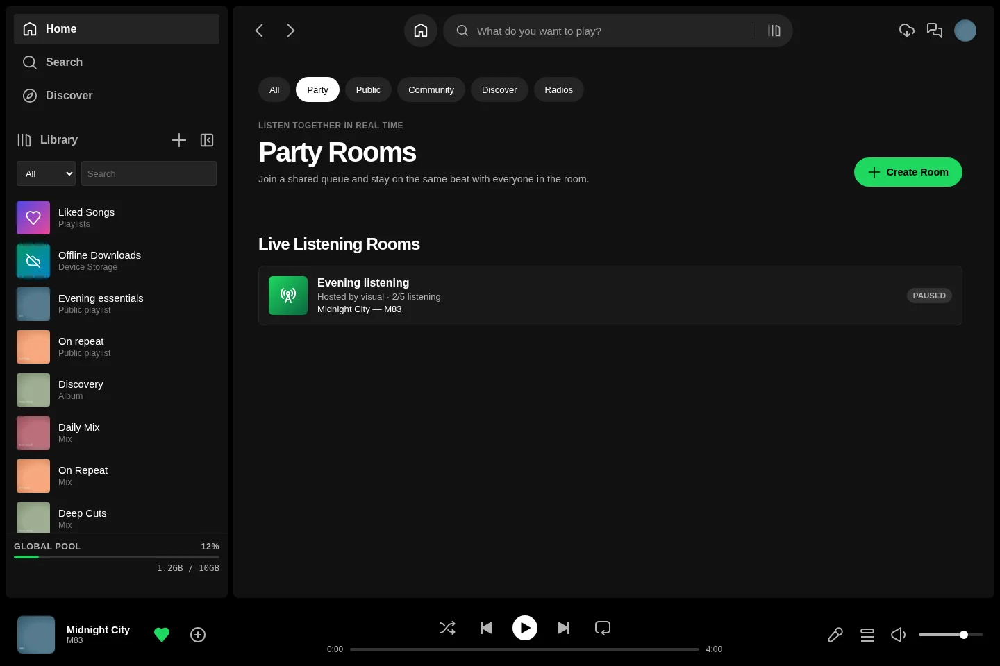</a></td>
  </tr>
</table>

### Web on your phone

The responsive web/PWA interface keeps browsing, downloads and playback within reach. Open the fullscreen player for artwork and lyrics, or keep the compact player visible while exploring. Supported local tracks and collections can be saved for offline use; browser capabilities and storage limits vary by device.

<table>
  <tr>
    <td width="33%" align="center"><a href="docs/images/screenshots/mobile-classic-library.webp">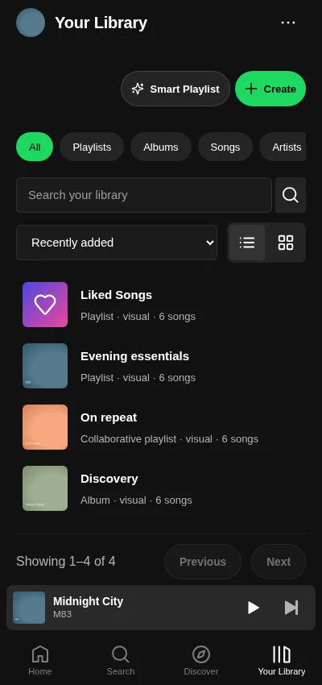</a></td>
    <td width="33%" align="center"><a href="docs/images/screenshots/mobile-glass-discovery.webp">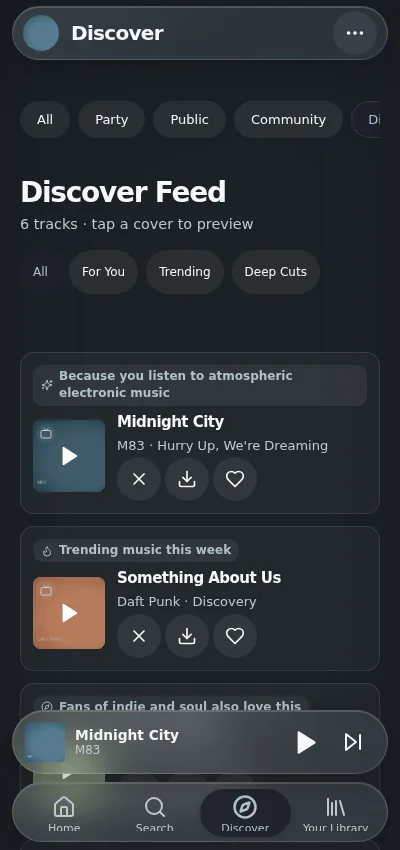</a></td>
    <td width="33%" align="center"><a href="docs/images/screenshots/mobile-vitrine-player.webp">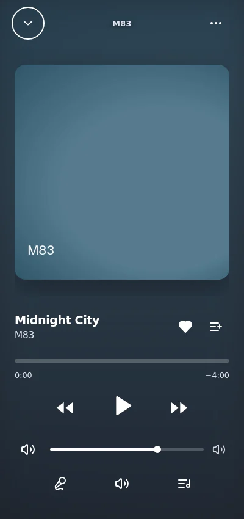</a></td>
  </tr>
</table>

### Native Android

The Android APK has native browsing and playback, background media controls, account-bound device downloads, home-screen widgets and an optional music island. Enter your server URL at first launch, then use the same account and theme. The installed web client and original wrapper remain available as compatibility options. [Android guide](docs/ANDROID.md)

<table>
  <tr>
    <td width="33%" align="center"><a href="docs/images/screenshots/android-classic-home.webp">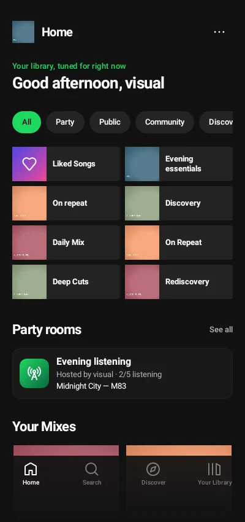</a></td>
    <td width="33%" align="center"><a href="docs/images/screenshots/android-glass-discovery.webp">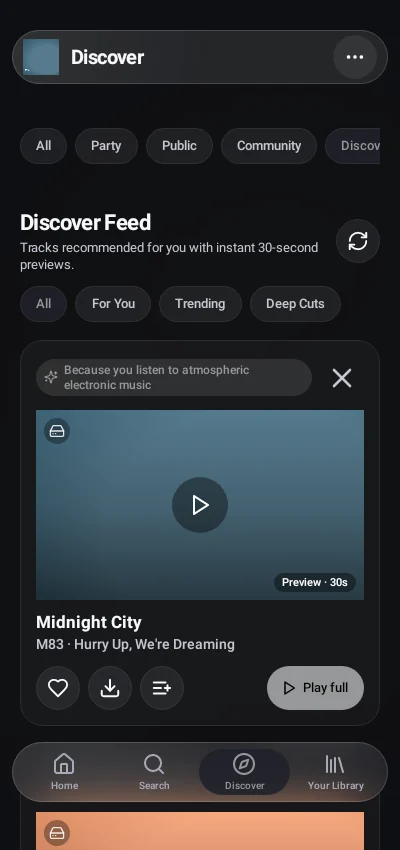</a></td>
    <td width="33%" align="center"><a href="docs/images/screenshots/android-vitrine-player.webp">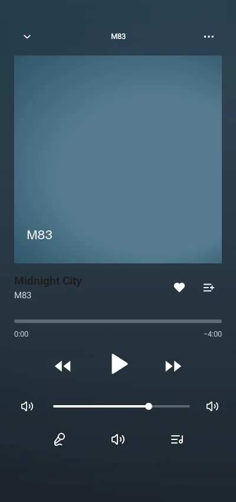</a></td>
  </tr>
</table>

### Your server, under control

Administration separates users, the library explorer, duplicate review and federation. System Monitor groups host status, statistics, updates, backups and Wrapped controls. Download Manager shows the isolated worker and provider-session status. These pages require an administrator account. [Administration guide](docs/ADMINISTRATION.md)

<table>
  <tr>
    <td width="50%" align="center"><a href="docs/images/screenshots/desktop-classic-monitor.webp">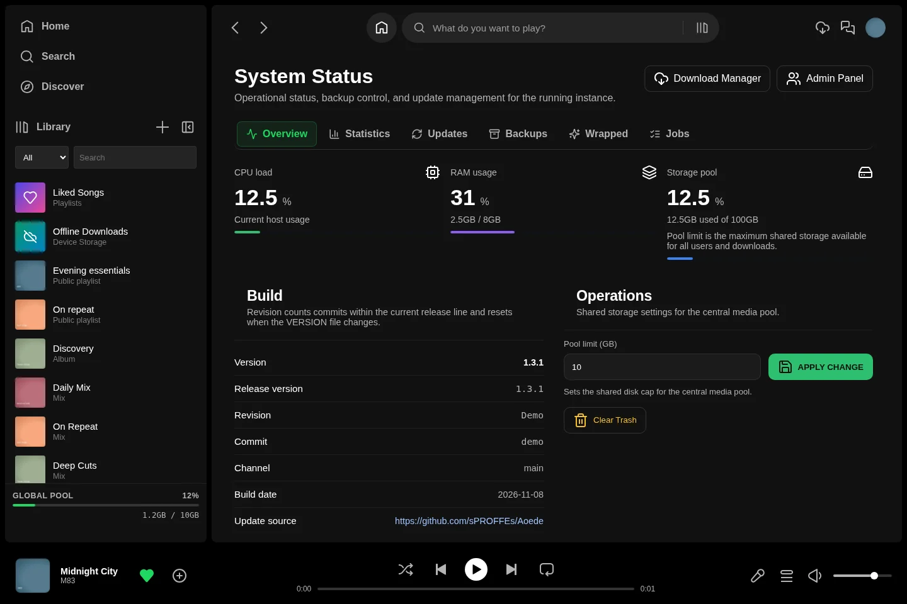</a></td>
    <td width="50%" align="center"><a href="docs/images/screenshots/desktop-vitrine-providers.webp">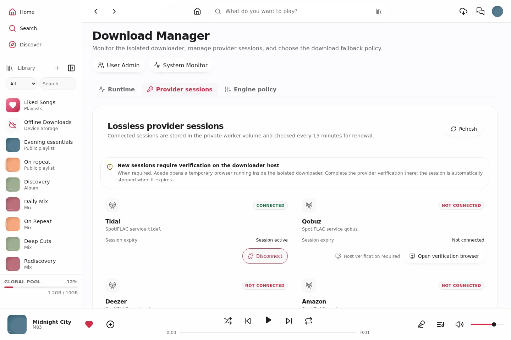</a></td>
  </tr>
</table>

**[Open the complete screenshot gallery →](docs/SCREENSHOTS.md)**

The gallery covers all three themes on desktop, mobile web and native Android, including playlists and albums, artists, public profiles, collaboration, imports, offline music, lyrics, queues, Wrapped, settings, administration, widgets and the music island. Component previews show the actual native controls, without inventing a phone home or lock screen.

## Clients

Start in your browser or choose a client for your device. Every client connects to an Aoede server; the Android and desktop apps ask for its address on first launch.

| Platform | Experience | Get started |
|---|---|---|
| **Web / PWA** | Responsive desktop and mobile interface, with browser installation where supported. | [User guide](docs/USER-GUIDE.md) |
| **Android APK** | Native interface and playback, background controls, widgets, optional music island, device downloads and verified update installation. | [Download APK](https://github.com/sPROFFEs/Aoede/releases/latest/download/aoede-android.apk) · [Android guide](docs/ANDROID.md) |
| **iPhone / iPad** | Web/PWA or the iOS WebKit wrapper with background audio and system media controls; IPA installation requires signing/sideloading. | [Download IPA](https://github.com/sPROFFEs/Aoede/releases/latest/download/aoede-ios.ipa) · [iOS guide](docs/IOS.md) |
| **Windows, macOS, Linux** | Desktop wrappers that open your server's web interface in an application window. | [Downloads](https://github.com/sPROFFEs/Aoede/releases/latest) · [Desktop guide](docs/DESKTOP.md) |
| **Subsonic clients** | Connect a compatible client to your account's Navidrome endpoint. | [Connection guide](docs/SUBSONIC.md) |

The releases page includes [complete Android source](https://github.com/sPROFFEs/Aoede/releases/latest/download/aoede-android-source.zip), the previous installed web client and the original Android remote wrapper as compatibility backups. Server, native APK and wrapper versions are independent; use the stable download links above to get the current artifacts. Browser offline storage and background behavior depend on the device; federation streaming and collaborative edits require a connection. [Client details and limits →](docs/ANDROID.md)

## Quick start

**Recommended host:** Linux, Docker Engine with the Compose plugin, 2+ CPU cores, 4 GB RAM and enough storage for your music. SSD storage is recommended.

The default deployment uses **Cloudflare Tunnel**. Before running setup, configure a strong `SECRET_KEY`, your `DOMAIN` and your `TUNNEL_TOKEN` in `.env`. For LAN/VPN or direct-domain hosting, choose the appropriate [deployment guide](docs/DEPLOYMENT.md) first.

```bash
git clone https://github.com/sPROFFEs/Aoede
cd Aoede/Aoede
cp .env.example .env
nano .env
chmod +x setup.sh
./setup.sh
```

Setup prepares the stack and can create the first administrator and import an existing library. Open your configured URL, sign in and configure any discovery providers you want to use.

[Full installation guide](docs/INSTALLATION.md) · [Provider configuration](docs/CONFIGURATION.md) · [Import an existing collection](docs/IMPORTING-MUSIC.md)

## Documentation

The README is the overview. The guides cover setup, everyday use and server operation.

| Start here | What it covers |
|---|---|
| [Installation](docs/INSTALLATION.md) | Host requirements, first launch and initial setup. |
| [User guide](docs/USER-GUIDE.md) | Library, discovery, playlists, player, offline listening and community features. |
| [Screenshot gallery](docs/SCREENSHOTS.md) | Desktop, mobile web and native Android in every theme. |
| [Party Rooms](docs/PARTY-ROOMS.md) | Synchronized listening, host controls and federated rooms. |
| [Administration](docs/ADMINISTRATION.md) | Accounts, downloads, library tools, monitoring and updates. |
| [Backup & restore](docs/BACKUP-RESTORE.md) | Application backups and recovery. |
| [Troubleshooting](docs/TROUBLESHOOTING.md) | Connection, playback, download and startup diagnostics. |

[Browse all documentation](docs/README.md) · [Security](docs/SECURITY.md)

## Project and license

Aoede is **source-available under a Personal Use Only license**. Private, personal, non-commercial use and modification are permitted. Commercial use, redistribution and offering it as a hosted service require prior written permission. Read the [full license](LICENSE) for the terms.

Found a bug or have an idea? [Open an issue](https://github.com/sPROFFEs/Aoede/issues). If Aoede is useful to you, a star helps other self-hosters find the project.
