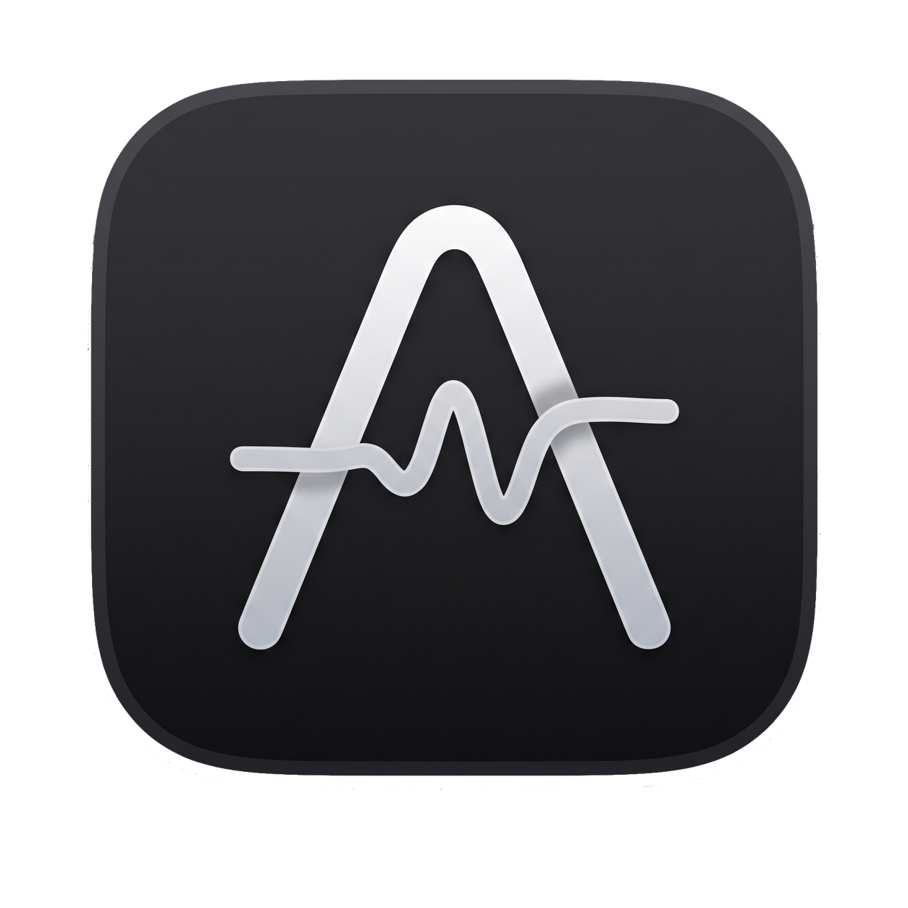
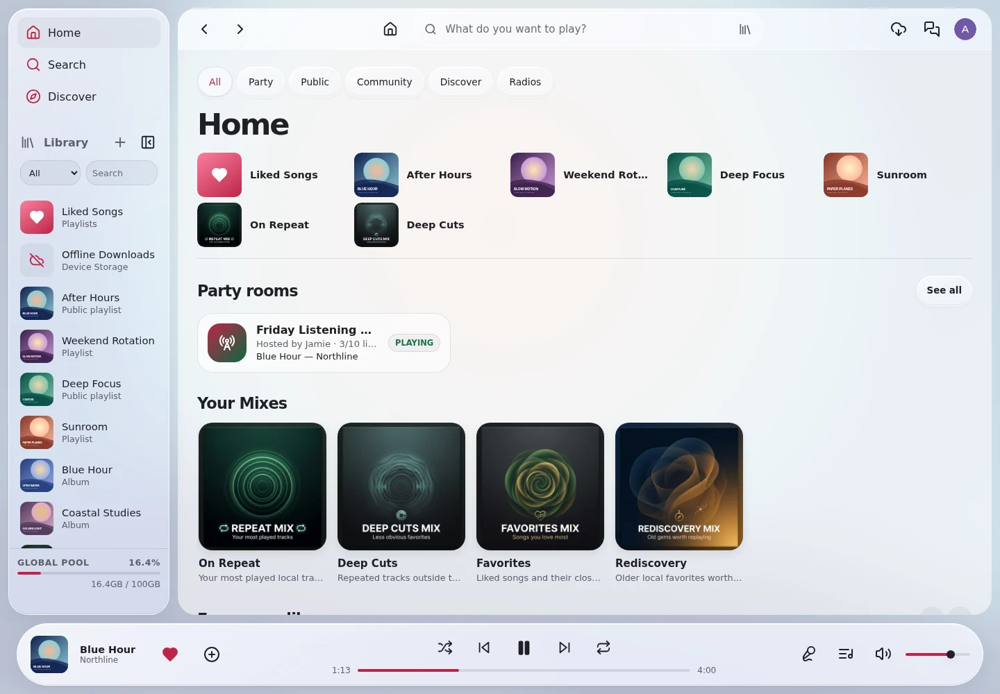
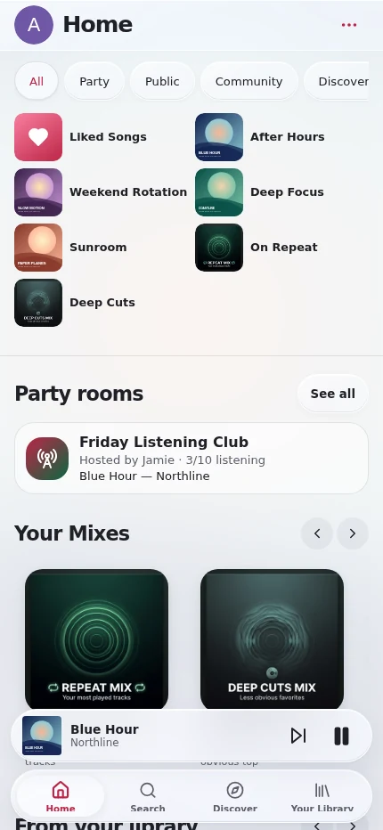
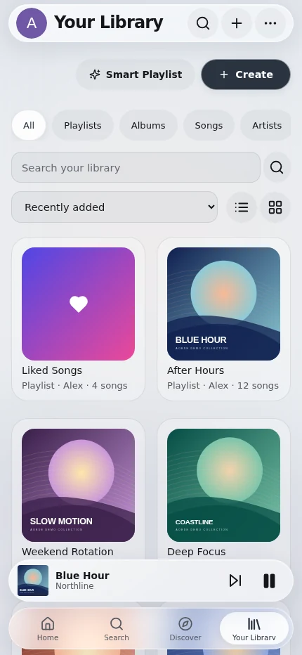
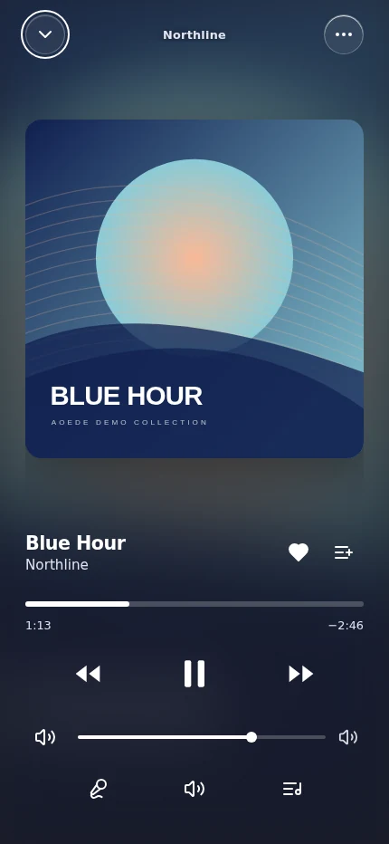
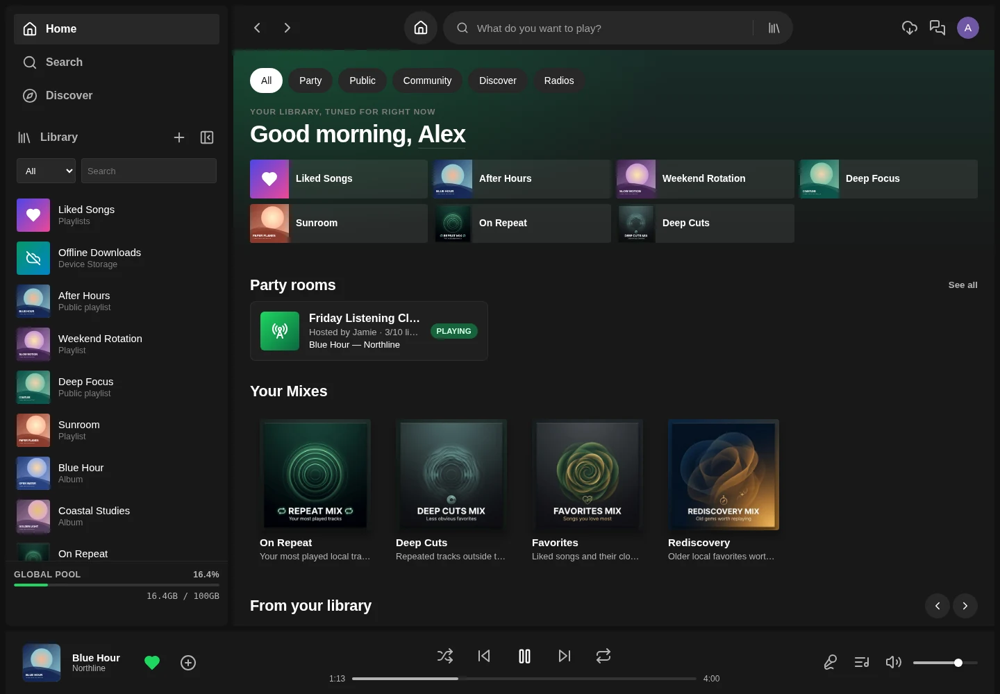
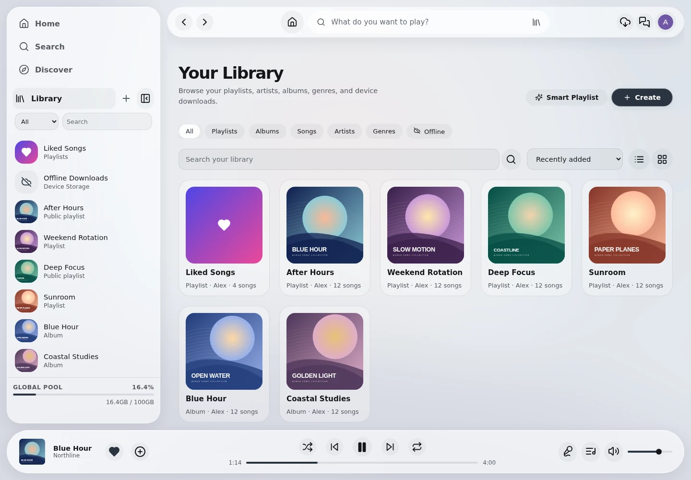

<p align="center">
  
</p>

<h1 align="center">Aoede</h1>

<p align="center"><strong>Your music. Your server. Your people.</strong></p>

<p align="center">
  A self-hosted music platform for discovering, collecting and listening together.<br>
  Built around Navidrome, with a shared music pool and a personal space for every listener.
</p>

<p align="center">
  <a href="https://github.com/sPROFFEs/Aoede/actions/workflows/quality.yml"></a>
  <a href="https://github.com/sPROFFEs/Aoede/releases/latest"></a>
  <a href="LICENSE"></a>
</p>

<p align="center">
  <a href="#why-aoede">Features</a> ·
  <a href="#screenshots">Screenshots</a> ·
  <a href="#clients">Get the app</a> ·
  <a href="#quick-start">Quick start</a> ·
  <a href="docs/README.md">Documentation</a>
</p>

<p align="center">
  <a href="docs/images/screenshots/desktop-vitrine.webp"></a>
</p>

<p align="center"><sub>Vitrine on desktop. Real frontend captures with a local demo library; mobile images below show the responsive web interface.</sub></p>

## Why Aoede?

Bring your library, discovery and shared listening into one place. Keep the audio on your own server, build collections that feel personal, and make listening a shared experience when you want it to be.

| | What you can do |
|---|---|
| **Discover and collect** | Search your library, Spotify and YouTube. Preview supported results and import supported album or playlist URLs into your own collections. |
| **Make it yours** | Organize playlists and curated albums, save favorites, build rule-based smart playlists and explore personal mixes. |
| **Listen together** | Invite collaborators, publish collections and join synchronized Party Rooms with shared queues. |
| **Connect your servers** | Optional **federation (beta)** connects catalogues, public profiles, collections, collaboration and parties across Aoede nodes. |
| **Keep listening** | Enjoy synchronized lyrics, the queue, live radio and a sleep timer. Save supported local tracks for offline listening. |
| **Look back** | Explore your listening statistics and an animated annual Aoede Wrapped when enabled by your administrator. |
| **Stay in control** | Manage users, downloads, library maintenance, duplicate review, backups and updates from the administration interface. |

Each regular account gets its own Navidrome instance, while the shared music pool lets users reuse audio without storing another copy for every account. [See how it works →](docs/ARCHITECTURE.md)

## Screenshots

### A player that fits your screen

<table>
  <tr>
    <td width="33%" align="center"><a href="docs/images/screenshots/mobile-home.webp"></a></td>
    <td width="33%" align="center"><a href="docs/images/screenshots/mobile-library.webp"></a></td>
    <td width="33%" align="center"><a href="docs/images/screenshots/mobile-player.webp"></a></td>
  </tr>
  <tr>
    <td align="center"><strong>Your daily listening</strong></td>
    <td align="center"><strong>Your collections</strong></td>
    <td align="center"><strong>Just the music</strong></td>
  </tr>
</table>

Browse your library on a phone, keep the compact player with you, or open the fullscreen player for artwork, lyrics and the queue.

### Three themes, one library

Choose **Classic**, **Glass** or **Vitrine** in your account settings. Your preference follows your account across devices. Classic keeps the dark, focused interface; Glass adds translucent surfaces; Vitrine brings an Apple Music inspired layout and rose accents. [Explore the themes →](docs/THEMES.md)

<table>
  <tr>
    <td width="50%"><a href="docs/images/screenshots/desktop-classic.webp"></a></td>
    <td width="50%"><a href="docs/images/screenshots/desktop-glass.webp"></a></td>
  </tr>
  <tr>
    <td align="center"><strong>Classic</strong> · Familiar, dark and focused</td>
    <td align="center"><strong>Glass</strong> · Translucent and artwork-aware</td>
  </tr>
</table>

All gallery images are stored in this repository. [Capture details and replacement guide →](docs/SCREENSHOTS.md)

## Clients

Start in your browser or choose a client for your device. Every client connects to an Aoede server; the Android and desktop apps ask for its address on first launch.

| Platform | Experience | Get started |
|---|---|---|
| **Web / PWA** | Responsive desktop and mobile interface, with browser installation where supported. | [User guide](docs/USER-GUIDE.md) |
| **Android** | Frontend bundled inside the APK, native media controls, background playback, home-screen widgets, offline music and verified in-app update downloads. | [Download APK](https://github.com/sPROFFEs/Aoede/releases/latest/download/aoede-android.apk) · [Android guide](docs/ANDROID.md) |
| **Windows, macOS, Linux** | Desktop wrappers that open your server's web interface in an application window. | [Downloads](https://github.com/sPROFFEs/Aoede/releases/latest) · [Desktop guide](docs/DESKTOP.md) |
| **Subsonic clients** | Connect a compatible client to your account's Navidrome endpoint. | [Connection guide](docs/SUBSONIC.md) |

The releases page also includes the complete Android source and the original Android remote wrapper as a backup. Browser offline storage and background behavior depend on the device; federation streaming and collaborative edits require a connection. [Client details and limits →](docs/ANDROID.md)

## Quick start

**Recommended host:** Linux, Docker Engine with the Compose plugin, 2+ CPU cores, 4 GB RAM and enough storage for your music. SSD storage is recommended.

The default deployment uses **Cloudflare Tunnel**. Before running setup, configure a strong `SECRET_KEY`, your `DOMAIN` and your `TUNNEL_TOKEN` in `.env`. For LAN/VPN or direct-domain hosting, choose the appropriate [deployment guide](docs/DEPLOYMENT.md) first.

```bash
git clone https://github.com/sPROFFEs/Aoede
cd Aoede/Aoede
cp .env.example .env
nano .env
chmod +x setup.sh
./setup.sh
```

Setup prepares the stack and can create the first administrator and import an existing library. Open your configured URL, sign in and configure any discovery providers you want to use.

[Full installation guide](docs/INSTALLATION.md) · [Provider configuration](docs/CONFIGURATION.md) · [Import an existing collection](docs/IMPORTING-MUSIC.md)

## Documentation

The README is the overview. The guides cover setup, everyday use and server operation.

| Start here | What it covers |
|---|---|
| [Installation](docs/INSTALLATION.md) | Host requirements, first launch and initial setup. |
| [User guide](docs/USER-GUIDE.md) | Library, discovery, playlists, player, offline listening and community features. |
| [Party Rooms](docs/PARTY-ROOMS.md) | Synchronized listening, host controls and federated rooms. |
| [Administration](docs/ADMINISTRATION.md) | Accounts, downloads, library tools, monitoring and updates. |
| [Backup & restore](docs/BACKUP-RESTORE.md) | Application backups and recovery. |
| [Troubleshooting](docs/TROUBLESHOOTING.md) | Connection, playback, download and startup diagnostics. |

[Browse all documentation](docs/README.md) · [Architecture](docs/ARCHITECTURE.md) · [Security](docs/SECURITY.md)

## Project and license

Aoede is **source-available under a Personal Use Only license**. Private, personal, non-commercial use and modification are permitted. Commercial use, redistribution and offering it as a hosted service require prior written permission. Read the [full license](LICENSE) for the terms.

Found a bug or have an idea? [Open an issue](https://github.com/sPROFFEs/Aoede/issues). If Aoede is useful to you, a star helps other self-hosters find the project.
