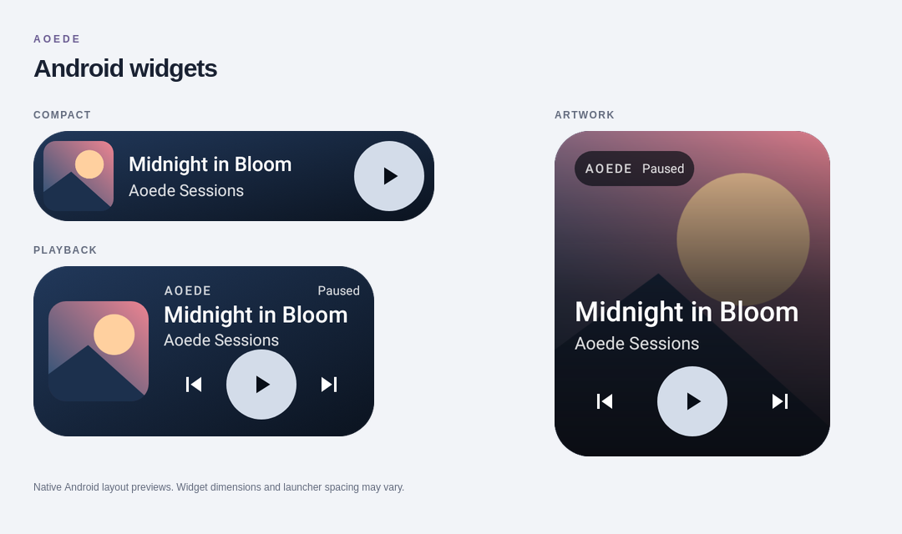

# Android App

Aoede Android 1.1.16 installs the player interface, JavaScript modules, themes, translations and icons inside the APK. A native Android host adds media controls, home-screen widgets, system file selection and device insets. The interface uses WebView; music and account data come from your chosen Aoede backend. Server-rendered settings/admin forms still need a connection.

Android 1.1.16 hides the island while any Aoede activity is visible and reveals it only after the app is minimized. A centered horizontal reveal/collapse animation follows the transition; reduced effects skip motion. Appearance settings keep a non-interactive live preview as the explicit exception. Handle and touch-extension width, height, vertical and horizontal position have separate sliders and one-unit arrows. The outline shows the actual rectangular touch area, including the capsule, handle and configured extension; Android still owns status-bar touches. The touch extension stays below that bar and at least 48dp tall/wide. Handle height 0 hides it; Reset layout clears all geometry overrides.

Background stream recovery now covers a pending play at a track boundary. It waits ten seconds without playable data or forward progress, preserves the current position, retries at most twice, and respects pause, source changes, offline blobs and party synchronization. It no longer reloads a stream merely because its fetch stalls while playable data remains. A late offline lookup cannot overwrite a newer selection. Native controls recover a missed playing event from actual playback progress; unavailable audio analysis uses the existing visual fallback without repeatedly opening audio contexts. These checks cover software failure paths, not a guarantee of network or OEM battery-policy behavior.

Android 1.1.15 retains the same compact window through screen-off and keyguard transitions. Unlocking no longer relies on recreating the island from an activity resume or a single OEM broadcast. Protected screen broadcasts accept the privileged OEM/system sender, and a delayed reconciliation handles events that arrive before PowerManager/Keyguard update. Sampling stops while asleep or locked; ordinary playback-position updates restart it after a missed unlock signal. The window requests lock-screen visibility where supported; it never wakes the display, dismisses keyguard or automatically launches an activity. Android/OEM lock-screen policy can still hide it; the existing media-session notification supplies standard lock-screen music controls.

The Appearance tab now contains the island settings. Each size/position slider has arrows for one-unit steps (1dp, or 1% horizontally), including keyboard increments. With the island enabled and overlay permission granted, the same capsule previews changes at its real screen position while settings stay open. The preview passes touches to the settings. Closing the editor hides it while Aoede remains visible; minimizing Aoede restores normal island controls. Offline artwork comes from the downloaded track blob, is resized to a bounded inline JPEG and reaches the existing native session, island, notification and widgets without an HTTP request.

Home now keeps a stable header and independent feed sections while recommendations, mixes, Wrapped and party rooms arrive. Repeated Home visits preserve unchanged artwork and shelf scroll; refreshing the same view does not first clear it to a loader. These shared frontend changes apply to all themes and the packaged Android UI; the web deployment must contain the updated frontend files.

Android 1.1.14 restores camera-aligned placement: the vertical slider measures distance from the screen top (0–240dp), with an 8dp default. A small handle below the protected status bar opens the same controls when Android intercepts taps on the capsule. The capsule and handle share one window, and the handle retains a 48dp touch area. Width/height, horizontal positioning, **Reset layout**, single-window transitions and Home/Recents/Back dismissal remain available.

Playback bars now use five measured frequency bands from a disposable copy of the WebView player's audio, sampled at up to 10Hz only while the compact island is visible and playing. This does not reroute or duplicate the audible output and requires no microphone permission. Silence produces still bars; unsupported/protected sources or unavailable analysis retain the original animation, as requested. Pause, reduced effects, expanded controls, screen lock, disabling the island and player destruction stop sampling and release its audio context/tracks.

**Dynamic Island (optional, native APK only):** open **User settings → Appearance → Dynamic Island · this Android device**, enable the switch and approve Android's **Display over other apps** permission. It is off by default and stored on this device, independently of other clients. The compact black capsule shows the current cover and playback bars. Tap it for artwork, title/artist, progress and seeking, previous/play/pause/next, favorites, shuffle and repeat. Availability follows the normal player, including local pauses in party rooms. Tap outside the card to collapse it; tap its artwork, copy or **Open player** to bring Aoede's current fullscreen player forward without restarting the track.

The island appears only while Aoede is minimized and its task or active background playback remains alive. Dismissing a paused app's task, disabling the feature, changing the backend or destroying the player removes it. Android removes its windows when the process is killed/force-stopped; the island never starts a keep-alive service or launches on boot. Android controls visibility while asleep or locked; Aoede retains the compact window for automatic restoration after unlocking. Music uses the existing playback service and session. Size and position settings apply to the compact capsule; the expanded player aligns with it while staying inside the screen and scrolling when needed. Android keeps its status bar above application overlays: the capsule may visually surround the camera, while its small lower handle remains accessible below the bar. An opaque system bar can still cover the part behind it. Existing nonzero gap settings preserve their lower placement; **Reset layout** restores the 8dp top offset. Android reserves critical system UI and some devices block overlays: this is an application overlay inspired by ColorOS, not access to ColorOS's private system island. No accessibility or notification-reading permission is used. The browser, desktop clients and original Android remote wrapper do not gain this feature.

Android 1.1.11 hardens rendering of remote party information and radio station IDs. Update the server to Aoede 1.2.9 as well for the authentication, media-relay and upload fixes described in the [security review](SECURITY-REVIEW-2026-10-24.md). The original 1.0.5 wrapper backup remains available.

Android 1.1.10 fixes final-track Next in all themes, including system/widget controls. With no next song and shuffle/repeat off, it leaves the track and player intact. Natural completion releases the audio source and media session and closes fullscreen playback correctly.

Android 1.1.4 fixes native login HTML preparation so JavaScript comments containing `<head>` cannot receive an extra script injection or appear beside the form. Fullscreen artwork now uses the same pause/play zoom in all three themes and respects reduced motion.

## Update notices

Android **1.1.9** adds an in-app updater. Install it once to enable checks against the official release, including when the backend is older. Future updates offer APK download, SHA-256 and signing-certificate verification, and the Android installer. Installation always requires Android confirmation; Android 8+ may also request permission to install from Aoede. No uninstall is needed for a compatible distribution-signed upgrade. Cancelling or declining permission preserves the current installation.

Notices compare the installed client with the published APK version, rather than the server/release tag. They can be postponed for one day and revisited in **More → About & updates**. Legacy remote wrappers use the backend notice and a manual download; install the current packaged APK to gain the native installer. The 1.0.5 backup remains unchanged.

## Release artifacts

The project documents two Android artifacts alongside releases:

- `aoede-android.apk` — installable APK.
- `aoede-android-source.zip` — complete Android Studio project, frontend compiler and editable frontend sources.
- `aoede-android-wrapper-1.0.5.apk` and `aoede-android-wrapper-1.0.5-source.zip` — preserved original remote-wrapper backup, for servers without the new bootstrap API.

The backup and new client use the same Android package identity. They cannot be installed side by side; Android normally requires uninstalling the newer version before reinstalling an older APK, removing local app data. Download any needed backup before switching.

Release page:

```text
https://github.com/sPROFFEs/Aoede/releases
```

## Requirements

Android **5.0+**, a current Android System WebView and a backend exposing `/api/mobile/bootstrap` protocol 1 are required. Update the Aoede backend alongside this APK. An older backend displays an update instruction; a connection failure offers Retry and server configuration.

The bootstrap endpoint uses the existing signed session cookie and checks expiry, revocation, account activity, service-account exclusion and session version. It returns only the authenticated account's display context and the same shared quota shown in the portal, never passwords, tokens, provider credentials or another user's profile. Responses are private and cannot be cached. Invalid sessions return 401; a session-verification outage returns a generic 503 without logging the user out. Browser origin policy/CORS still governs reads, and the Android bridge accepts only the configured origin's main frame, including its exact port.

## Install

1. Download `aoede-android.apk` to the device.
2. If Android asks, allow **Install unknown apps** for the browser or file manager you used.
3. Open the APK and install it.
4. Launch Aoede.
5. Enter your Aoede server URL, for example:

   ```text
   https://aoede.example.com
   ```

6. Connect and sign in with the same credentials as the web application.

## Features

The application provides:

- an installed frontend with Classic, Glass and Vitrine themes, without startup CDN requests;
- edge-to-edge phone and touch-landscape layouts with safe controls around cutouts and system bars;
- a dock that adapts to playback and the keyboard, compact Vitrine spacing and a mobile More menu;
- Android Back dismissing dialogs, fullscreen playback and menus before navigating;
- **More → About & updates** with the server version, release highlights and current Android/desktop downloads (requires the updated backend);
- a resizable **Aoede player** widget with compact, full-control and large-artwork layouts, cover-based colours and a prominent play/pause button;
- native system media notification;
- album artwork, title and artist in the notification;
- play / pause / next / previous media actions;
- background playback that continues when the screen is off or the app is not foregrounded;
- headphone/Bluetooth disconnection pause, including a local pause in party rooms;
- offline startup with the last validated account and existing downloaded tracks;
- configurable server URL from login, connection errors and user settings;
- a device-local **Reduce visual effects** option, enabled by default on low-memory devices.

Add the widget from your launcher's widget picker. During playback, controls operate in the background; when the player process is absent, a tap opens Aoede. Force-stopping the application ends playback. Music that has not been downloaded and online/federation/admin functions require the backend.



Native layout previews rendered by the Android view tests; dimensions and launcher spacing vary by device.

The APK keeps the backend's original origin, scheme and port for authentication, API calls, streaming and uploads. HTTP can be explicitly configured, while invalid HTTPS certificates remain blocked. Upgrading 1.0.4/1.0.5 preserves the package identity and distribution signature, login cookies and downloaded files. APK 1.0.3 used a lost debug signing key and still needs uninstalling first.

## Changing server URL

Use **Configure server** in user settings or the gear on the login/connection screen. Enter the root URL, including a custom port if needed; do not include `/portal` or another path. Saving reloads the player. Theme preferences remain attached to the backend account, while effects preferences stay on this device.

Build instructions, signing configuration and device acceptance checks are in [the Android project guide](../android/README.md).

## README screenshot recommendation

Use a portrait capture that shows the actual Aoede player, not the Android launcher. Avoid notification content with personal names, private domains or sensitive album/library metadata you do not want public.

See [Screenshot Guide](SCREENSHOTS.md).
